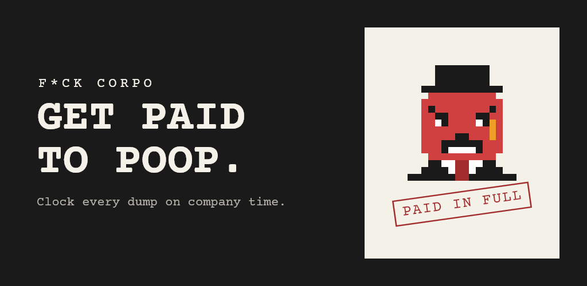
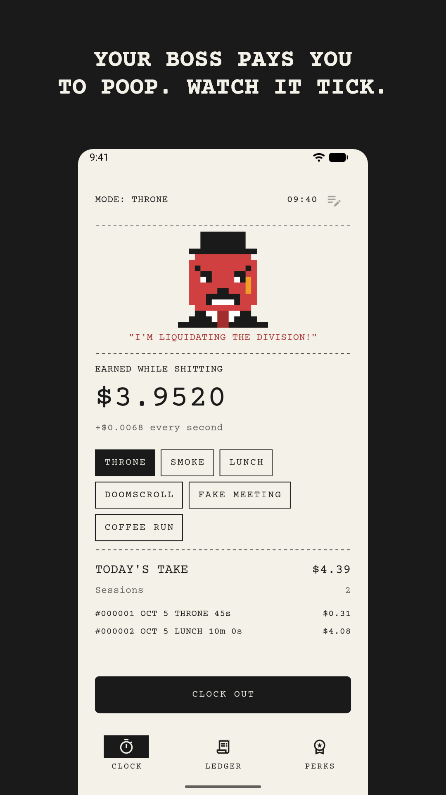
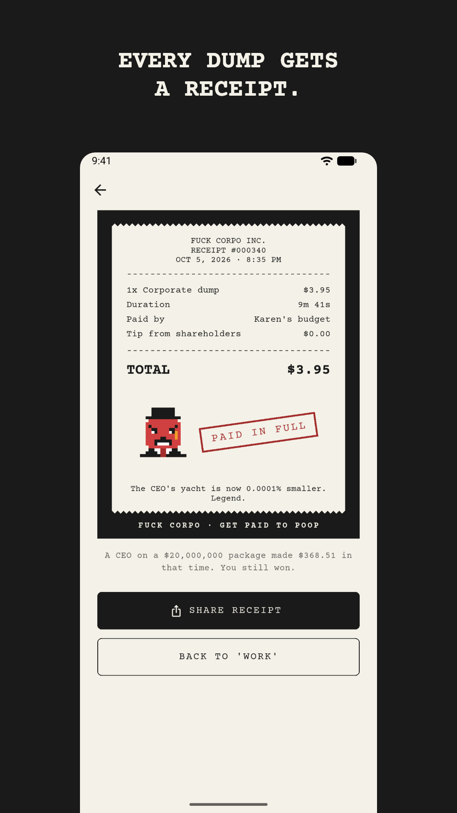
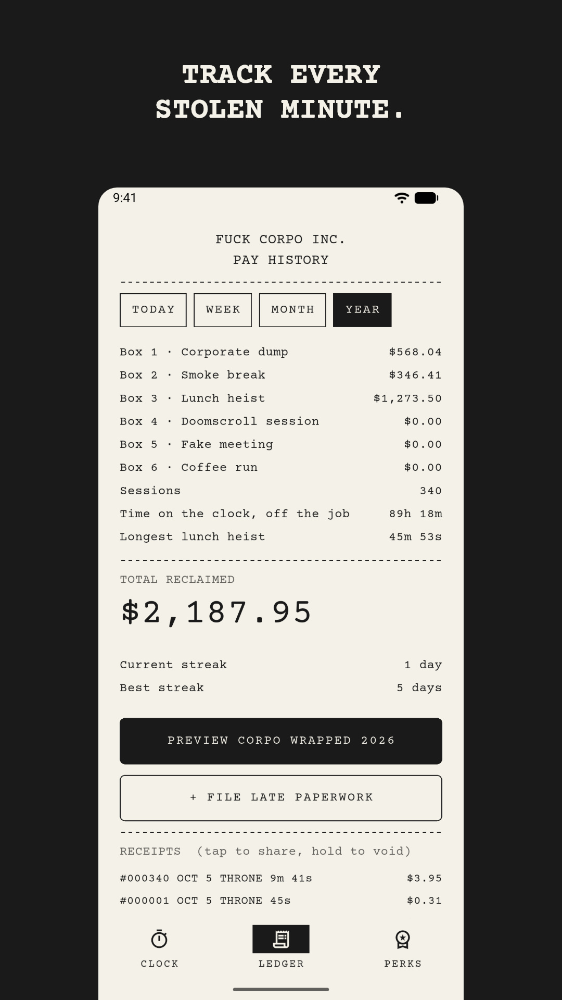
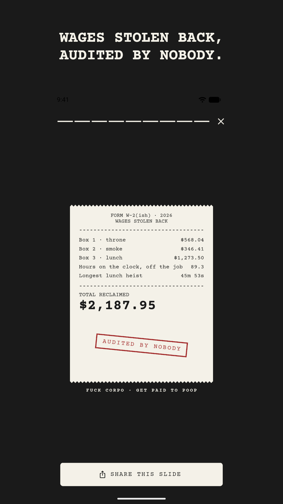

<p align="center">
  
</p>

<h1 align="center">FUCK CORPO INC.</h1>

<p align="center">
  <b>Your boss pays you to shit. Might as well track it.</b>
</p>

<p align="center">
  
  
  
  
  <a href="https://fuckcorpov2-web.vercel.app"></a>
</p>

```text
                    FUCK CORPO INC.
                  RECEIPT #000340
               OCT 5, 2026 · 8:35 PM
 -------------------------------------------------
 1x Corporate dump                          $3.95
 Duration                                  9m 41s
 Paid by                           Karen's budget
 Tip from shareholders                      $0.00
 -------------------------------------------------
 TOTAL                                      $3.95

                 [ PAID IN FULL ]

    The CEO's yacht is now 0.0001% smaller. Legend.
```

A satirical Android app that clocks every dump, smoke break, and lunch heist you take on company time, prints you a receipt for it, and hands you a year-end W-2 of wages stolen back. A pixel-art fat-cat CEO watches the whole time and gets angrier with every cent.

---

## The paperwork

<table>
  <tr>
    <td></td>
    <td></td>
    <td></td>
    <td></td>
  </tr>
  <tr>
    <td align="center"><sub>CLOCK IN</sub></td>
    <td align="center"><sub>GET A RECEIPT</sub></td>
    <td align="center"><sub>CHECK THE LEDGER</sub></td>
    <td align="center"><sub>FILE YOUR W-2(ISH)</sub></td>
  </tr>
</table>

## Line items

| Box | Feature | What it does |
|---|---|---|
| 1 | **Live money ticker** | Clock in, watch your pay tick up to four decimals while the CEO goes from smug to "SECURITY!!" |
| 2 | **Throne, Smoke, Lunch** | Three ways to get paid for not working. Hourly or salary, in $, € or £. |
| 3 | **Receipts** | Every session prints a torn-paper receipt with a roast, ready for the group chat. |
| 4 | **Ledger** | Today, week, month, year. Longest session. Streaks. Late paperwork for the ones you forgot. |
| 5 | **Corpo Wrapped** | Swipeable year-in-review slides: total reclaimed, peak slacking season, how fast the CEO earns your whole haul. |
| 6 | **Night shift** | Carbon-copy dark mode, or keep it on paper. Your call. |
| 7 | **Zero surveillance** | No account, no ads, no analytics. Your ledger never leaves the phone. HR will never know. |

## Promotion to Management

One-time Pro unlock through Google Play. No subscription. We're not monsters.

- **3 more breaks:** Doomscroll, Fake Meeting, Coffee Run
- **10 achievements:** Snip It Off, The Marathon, Mogul, Union Rep, Grand Larceny, and more
- **3 receipt styles:** Gold Receipt, CEO Memo, Strike Poster
- **Unhinged roast pack:** meaner receipts, HR would not approve
- **CSV export:** for spreadsheets, or the union

## How the math works

```text
hourly   ->  wage / 3,600                         per second
salary   ->  salary / (hours per week x 52 x 3,600)   per second
earned   ->  per second x seconds on the throne
```

Same formula on the [website calculator](https://fuckcorpov2-web.vercel.app). The CEO comparison uses a hypothetical $20M pay package, because satire.

## Built with

| Layer | Stack |
|---|---|
| App | Flutter, Riverpod, drift (SQLite), shared_preferences |
| Look | Courier Prime, hand-rolled pixel CEO, flutter_animate |
| Sharing | share_plus, 1080x1350 PNG receipts and slides |
| Money | `in_app_purchase` (Google Play Billing), product `pro_unlock` |
| Website | Plain HTML, CSS, and JS on Vercel |

## Filing cabinet

```text
app/                 Flutter app (Android)
  lib/core/          pay math, stats, Wrapped, achievements, theme
  lib/data/          drift database, preferences, CSV export
  lib/features/      timer, receipt, ledger, wrapped, pro, onboarding
  lib/copy/          every roast and CEO quote (edit jokes here)
  tool/              store asset generator
  store_assets/      Play icon, feature graphic, screenshots
web/                 landing page, calculator, privacy policy
```

Deeper maps for humans and AI agents: [`memory.md`](memory.md), [`CODE_MAP.md`](CODE_MAP.md), [`ENTRY_POINTS.md`](ENTRY_POINTS.md), [`DATA_FLOW.md`](DATA_FLOW.md), [`FEATURE_BOUNDARIES.md`](FEATURE_BOUNDARIES.md).

## Clocking in (dev setup)

```bash
cd app
flutter pub get
flutter test
flutter run
```

Personal build with Pro unlocked (never upload this one to Play):

```bash
flutter build apk --release --dart-define=UNLOCK_PRO=true
```

Play bundle (needs `app/android/key.properties` and your upload key):

```bash
flutter build appbundle --release
```

Regenerate launcher icons and store graphics:

```bash
flutter test tool/generate_store_assets_test.dart
```

## Status

- [x] App, Pro, and billing built
- [x] Store listing assets
- [x] Website and privacy policy live
- [ ] Upload key and Play Console listing
- [ ] 14-day closed test with 12 testers
- [ ] Real domain
- [ ] iOS

## Fine print

Fuck Corpo is satire. We don't encourage time theft; we just do the math. Don't get fired.

Courier Prime is used under the SIL Open Font License 1.1.

<p align="center"><sub>AUDITED BY NOBODY</sub></p>
